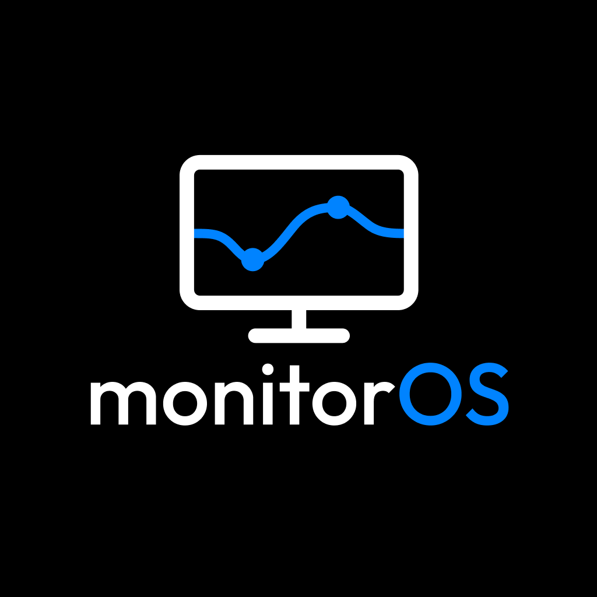

<p align="center">
  
</p>

<p align="center">
  <strong>Turn a 2017 27-inch Retina 5K iMac into a 5K external display for your Mac.</strong>
</p>

<p align="center">
  <a href="https://github.com/eriskhan/monitorOS/actions/workflows/ci.yml">
    
  </a>
  <a href="LICENSE">
    
  </a>
  
  
</p>

<p align="center">
  <a href="#why">Why</a> ·
  <a href="#how-it-works">How it works</a> ·
  <a href="#getting-started">Getting started</a> ·
  <a href="#created-by">Created by</a> ·
  <a href="#thanks">Thanks</a> ·
  <a href="#license">License</a>
</p>

---

**monitorOS** turns a **2017 27-inch Retina 5K iMac (iMac18,3)** into a
cable-connected external display for a modern Mac.

It keeps the original iMac logic board, Radeon Pro GPU, 5120×2880 panel and
speakers in use. The source Mac gets a Retina virtual display, while the iMac
runs as a dedicated display appliance and renders the incoming desktop through
its own GPU.

No display-controller conversion board or internal hardware modification is
required.

monitorOS provides:

- **5120×2880 at 60 Hz** native stitched scanout on the iMac panel;
- a **Retina 5K virtual display** on macOS;
- automatic **Display P3** color profile initialization;
- low-latency video transport over **ThunderboltIP**;
- dirty-region transport for low-change desktop content;
- automatic discovery and reconnect through **Bonjour**;
- native-style **macOS brightness controls**, including fine adjustment;
- an **iMac Speakers** macOS audio output with volume and mute controls;
- a dedicated appliance boot mode while preserving regular Omarchy for
  recovery and development.

## Why

The 27-inch Retina 5K iMac still has an exceptional display.

Getting pixels into it is the difficult part.

Retina 5K iMacs do not support Apple's old Target Display Mode, and the common
way to reuse the panel is to remove much of the original hardware and install a
third-party display controller.

monitorOS takes a software-first approach.

macOS creates a virtual Retina display and captures it. The image is sent over
Thunderbolt to the iMac, where the Radeon Pro GPU converts and presents it
directly to the original 5K panel.

The same Thunderbolt connection carries brightness controls and audio.

The result is an iMac that behaves much more like a purpose-built external
display while keeping its original hardware intact.

## How it works

monitorOS runs on both sides of the Thunderbolt connection.

```text
Mac                                                   iMac18,3
───                                                   ────────

monitorOS                                             monitorosd
│                                                     │
├─ CGVirtualDisplay                                   ├─ Bonjour discovery
│    5120×2880 Retina                                 ├─ connection lifecycle
│                                                     └─ brightness / audio control
├─ ScreenCaptureKit
│
├─ Metal
│    full-range BT.709 4:2:2
│    dirty-region / delta transport
│
│                        ThunderboltIP
│
├───────── video :5202 ─────────────────────────────► imac5k-stream
│                                                     │
│                                                     ├─ Radeon Pro GPU
│                                                     │    GLES YUV → RGB
│                                                     │
│                                                     └─ DRM/KMS
│                                                          5120×2880 @ 60 Hz
│                                                                │
│                                                                ▼
│                                                           iMac panel
│
├──────── control :5203 ─────────────────────────────► brightness
│                                                     volume / mute
│
└─ iMac Speakers
     CoreAudio
         │
         └───── audio :5204 ─────────────────────────► PipeWire
                                                               │
                                                               ▼
                                                         iMac speakers
```

### Video

The source Mac creates a **5120×2880 Retina virtual display** using
`CGVirtualDisplay`.

ScreenCaptureKit captures the display, including the cursor. Frames are
converted into packed full-range BT.709 **4:2:2** data and transported over
ThunderboltIP.

For normal desktop workloads, monitorOS tracks changed regions so that small
updates such as cursor movement do not require transmitting an entire 5K frame.

On the iMac, the Radeon Pro GPU performs the YUV → RGB conversion and the
result is presented directly to the original panel through DRM/KMS.

### Brightness

The Mac's brightness keys control the physical iMac backlight.

The normal macOS brightness experience is preserved:

- F1 / F2 use **16 brightness levels**;
- Shift + Option + F1 / F2 expose **64 fine-grained levels**.

### Audio

monitorOS installs an **iMac Speakers** CoreAudio output device on macOS.

Selecting it sends audio over Thunderbolt to the iMac, where it is played
through the original internal speakers.

macOS volume and mute controls are relayed to the iMac as well.

## Getting started

> [!IMPORTANT]
> monitorOS currently targets **iMac18,3** — the 2017 27-inch Retina 5K iMac.

### What you need

#### iMac

- 2017 27-inch Retina 5K iMac (`iMac18,3`);
- Omarchy with `linux-omarchy`;
- Limine bootloader;
- network access during installation;
- a **40 Gbps Thunderbolt 3 cable**.

For completely unattended cold boot, install Omarchy without LUKS disk
encryption. monitorOS does not remove or modify existing disk encryption.

#### Mac

- **macOS 13 Ventura or newer**;
- a Mac with Thunderbolt connectivity to the iMac;
- a **40 Gbps Thunderbolt 3 cable** between the Mac and iMac;
- an administrator account or administrator password during installation;
- **Screen Recording** permission for monitorOS.

> [!IMPORTANT]
> The cable requirement is critical. Use a **Thunderbolt 3 cable rated for
> 40 Gbps**. A regular USB-C cable or a lower-bandwidth cable is not suitable
> for monitorOS's 5K video transport.

The administrator authorization is required because the installer places the
monitorOS application components and the **iMac Speakers** CoreAudio driver in
system locations.

When installing from a GitHub Release, **Xcode, Swift and the Command Line
Tools are not required**.

monitorOS is currently tested with a **Radeon Pro 580X iMac and an M3 Pro Mac**.

Other Radeon Pro configurations of iMac18,3 are expected to work as well,
including Radeon Pro 570-class systems, but have not yet been validated to the
same extent.

### 1. Install monitorOS on the iMac

On the iMac, open a terminal and run:

```sh
curl -fsSL https://raw.githubusercontent.com/eriskhan/monitorOS/main/scripts/install | bash
```

The installer:

- verifies the supported iMac18,3 environment;
- installs the required runtime dependencies;
- verifies or installs the qualified native 5K display support;
- verifies or installs the required iMac audio support;
- installs the monitorOS runtime and services;
- configures the Thunderbolt firewall rules;
- installs a persistent **monitorOS Appliance** Limine entry;
- preserves regular Omarchy as the graphical recovery and development
  environment.

Once installation is complete, reboot into **monitorOS Appliance**.

### 2. Install monitorOS on the Mac

Download the latest release:

**[Download monitorOS →](https://github.com/eriskhan/monitorOS/releases/latest)**

Open **monitorOS.pkg** and follow the standard macOS Installer steps.

macOS Installer will ask for administrator authorization while installing the
application and the **iMac Speakers** CoreAudio driver.

After installation, open **monitorOS** once from Applications. On first launch,
monitorOS asks whether to keep local analytics markers (nothing is uploaded
automatically), registers itself to start at login, and asks for **Screen
Recording** permission. Allow Screen Recording so monitorOS can capture the
virtual display.

### 3. Connect

Power on the iMac and connect it to the Mac with the **40 Gbps Thunderbolt 3
cable**.

monitorOS automatically discovers the iMac over Bonjour, establishes the
connection and brings up the virtual display.

From there:

- arrange the iMac in **System Settings → Displays**;
- use the normal Mac brightness keys to control the iMac panel;
- select **iMac Speakers** when you want sound through the iMac;
- unplug and reconnect the Thunderbolt cable whenever needed.

Connection and reconnection are automatic during normal operation.

## Created by

monitorOS is created and maintained by
**[Eriskhan Geshaev](https://geshaev.eu)**.

## Thanks

monitorOS builds on a lot of excellent open-source work.

Special thanks to:

| Project | What monitorOS uses it for |
| --- | --- |
| [Omarchy](https://github.com/basecamp/omarchy) | Linux environment running on the iMac |
| [omarchy-imac18-3](https://github.com/ahmadtv/omarchy-imac18-3) | Qualified iMac18,3 native 5K and hardware support |
| [imac18-3-cs8409-linux-audio](https://github.com/jackdanyell/imac18-3-cs8409-linux-audio) | CS8409 audio support for iMac18,3 |
| [snd_hda_macbookpro](https://github.com/davidjo/snd_hda_macbookpro) | Foundation of the CS8409 Linux audio work |
| [Limine](https://github.com/limine-bootloader/limine) | Appliance and recovery boot environment |
| [Linux](https://kernel.org/) | Kernel and hardware platform |
| [Mesa](https://www.mesa3d.org/), libdrm, GBM, EGL and OpenGL ES | Radeon rendering and display presentation |
| [PipeWire](https://pipewire.org/), [ALSA](https://www.alsa-project.org/) and [libsamplerate](https://github.com/libsndfile/libsamplerate) | iMac audio pipeline |
| [mdns-sd](https://crates.io/crates/mdns-sd) | Bonjour / mDNS discovery |
| [libc](https://crates.io/crates/libc) | Low-level Rust system interfaces |
| Apple's NullAudio AudioServerPlugIn sample | Foundation of the monitorOS CoreAudio output device |

monitorOS also relies on macOS technologies including **CGVirtualDisplay,
ScreenCaptureKit, Metal, ColorSync and CoreAudio**.

For exact provenance, pinned upstream revisions and license boundaries, see
[THIRD_PARTY_NOTICES.md](THIRD_PARTY_NOTICES.md).

## License

Except where otherwise noted, monitorOS source code is licensed under the
[MIT License](LICENSE).

Copyright © 2026 **Eriskhan Geshaev**.

Third-party and adapted components retain their original copyright and license
terms. Hardware-support and kernel components downloaded by the iMac installer
remain licensed under their respective upstream terms.

See [THIRD_PARTY_NOTICES.md](THIRD_PARTY_NOTICES.md) for complete third-party
licensing information.

Built with  ❤️ in Portugal  🇵🇹 